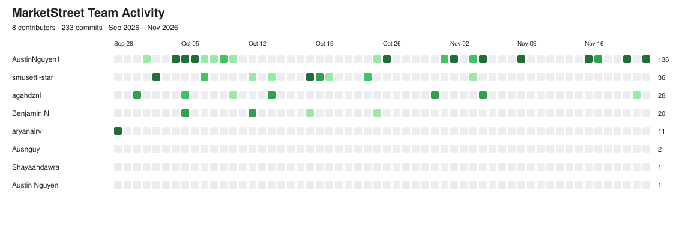

<p align="center">
  
</p>

MarketStreet is a simulated stock trading application that allows users to place and track paper-trading transactions without using real money.

## Live Site

**[Open MarketStreet: https://main.d2kb3xv6llewil.amplifyapp.com](https://main.d2kb3xv6llewil.amplifyapp.com)**

Sign in (or try guest mode), submit a trade, and copy the confirmation number from the receipt. To look it up later, open **Activity** and use **Check transaction status**. The site runs on AWS Amplify, API Gateway, Lambda, DynamoDB and Cognito. The backend runs in the class AWS Learner Lab, so the lab must be running for trades, Activity and the Learn quiz to work. Guest mode runs only in the browser.

For graders, the [Grader check page](https://main.d2kb3xv6llewil.amplifyapp.com/grader.html) shows the 36-case test matrix. Its 24 automated cases run live against the real AWS backend when you start them on the page (step 3). The other 11 cases are manual browser tests; the page lists their recorded results, but it does not re-run them.

**How a trade travels:** the browser (Amplify) sends JSON with `fetch()` to API Gateway. API Gateway checks the Cognito sign-in token and calls one Lambda (`aws/lambda/index.js`). The Lambda checks the business rules and saves the result to DynamoDB. It then returns a confirmation number, which the page can look up again with `GET`.

## Team Performance Tracker

**[Open the team participation tracker](docs/05-team-management/team-tracker.xlsx)** for all six members' participation in class activities, group exercises, and milestones. The workbook has three sheets: **Participation** (a 0–100 score per member for each dated activity), **Evidence** (each member's commits on `main` per week) and **Date key** (where each column's date comes from). See the [tracker guide](docs/05-team-management/README.md).

## Project Scenario

Many beginner investors want to practice trading and understand how stock transactions work without risking real money. MarketStreet provides a simplified environment where users can submit simulated stock trades and track the resulting transaction status.

## Main Transaction

The primary transaction is:

> **A user submits a simulated stock trade order.**

The system validates the transaction, applies applicable business rules, records the trade request, and returns a transaction status.

## System Design

[Browse the system design documents](docs/03-system-design/README.md) for the architecture, workflow, trade states, field definitions, and tier responsibilities.

## Application Interface

[`frontend/`](frontend/index.html) is the canonical MarketStreet interface. It supports Market orders only (BR-9) and sends trades to the AWS backend. The business rules live in **one module**, [`aws/lambda/backend/trades.js`](aws/lambda/backend/trades.js), which the Lambda calls for every order. The retired Express server in `archive/` is not part of the live path. Use the [live site](https://main.d2kb3xv6llewil.amplifyapp.com), or open `frontend/index.html` in a browser. Earlier class exercises and prototypes are preserved in [archive/](archive/README.md).

## Project Layout

| Folder | What it is |
|---|---|
| [`frontend/`](frontend/) | The website (HTML, CSS, JavaScript), deployed with AWS Amplify |
| [`aws/lambda/`](aws/README.md) | The live backend: the Lambda `MarketStreet-ProcessTrade` behind API Gateway, saving to DynamoDB |
| [`archive/local-backend/`](archive/local-backend/README.md) | The retired Week 8–9 Express server and business logic (`server/`, `backend/`), kept as coursework evidence |
| [`docs/`](docs/) | Requirements, business rules, system design, decisions, and the [presentation guide](docs/presentation-guide.md) |
| [`Testing/`](Testing/README.md) | Test plans, results, and evidence for each week |
| [`.github/workflows/`](.github/workflows/) | `test.yml` runs the Lambda tests on every push; `contributor-graph.yml` redraws the activity graph |

Each interactive page loads its own script, for example `trade.js` (stock page and order ticket), `activity.js` (Activity list and status lookup) and `result.js` (receipt). Every accepted or rejected order is saved as a record, so the Activity and Result pages show it. Shared state and helpers are in `app.js`. The stock symbol comes from the page address (`trade.html?symbol=AAPL`), not from a form field. The order is sent as `symbol` and `quantity`; the saved record names them `stockSymbol` and `shareQuantity` (see the [data dictionary](docs/03-system-design/data-dictionary.md#api-request-body)).

## Testing

- **Final test matrix (36 cases):** [Testing/Final-Milestone/README.md](Testing/Final-Milestone/README.md). 24 cases are automated and run live on the Grader check page. 11 are manual browser tests with recorded results.
- **Automated backend tests:** the test files in `aws/lambda/tests/`. GitHub Actions ([`.github/workflows/test.yml`](.github/workflows/test.yml)) runs them on every push and pull request.
- **All test plans and evidence, week by week:** [Testing/README.md](Testing/README.md).

### Run the tests

```
cd aws/lambda
npm ci
npm test
```

This runs 94 tests in 9 files (as of Nov 27) with Node's built-in test runner. They use an in-memory stand-in for DynamoDB, so no AWS account is needed.

## Git Workflow

By team convention, work goes on a feature branch, then into `main` through a pull request. GitHub does not enforce this: `main` has no branch protection and no required review, and some changes were committed straight to `main`. The test workflow runs on every push and pull request.

## Documentation

[Requirements](docs/02-requirements/requirements.md) · [Business rules and internal controls](docs/02-requirements/business-rules.md) · [User stories](docs/02-requirements/user-stories-acceptance.md) · [Architecture](docs/03-system-design/architecture.md) · [Data dictionary](docs/03-system-design/data-dictionary.md) · [Decision log](docs/decisions.md) · [AWS setup](aws/README.md) · [Final presentation guide](docs/presentation-guide.md) · [Week 13 platform test plan](Testing/Week-13-Platform/README.md)

## Project Purpose

The purpose of this project is to demonstrate the complete processing of a stock trading transaction from user input through validation, business rules, system processing, and record creation.

## Project Activity


## Team Members

Roles come from the [team charter](docs/01-project-foundation/team-charter.md).

| Member | Role |
|---|---|
| Austin Tran Nguyen | Team Leader, Requirements / Product Lead |
| Sophia Musetti | UI / Accessibility Lead |
| Agah Duzenli | JavaScript / Logic Lead, Technical Lead |
| Arya Nair | Git / Integration Lead |
| Shayaan M. Dawra | QA / Documentation Lead |
| Benjamin Nguyen | Support / Floater |

## Week 8–9 local backend (retired)

The Week 8 business logic and the Week 9 local Express server are archived. Their setup notes, test results and contributions are in [archive/local-backend/README.md](archive/local-backend/README.md).

## Week 11 — Saving Trades to DynamoDB

The Lambda (`MarketStreet-ProcessTrade`) still validates every trade with the existing business rules in [`aws/lambda/backend/trades.js`](aws/lambda/backend/trades.js). Every order is saved to the DynamoDB table `MarketStreetTrades` with a server-generated `transactionId`. Accepted and Rejected orders are both saved; only an Accepted order changes the account (D-18).

- `POST /api/trades` checks the order and saves the result (`persisted: true`).
- `GET /api/trades/{transactionId}` returns one saved trade.

[View the Week 11 setup and test results](Testing/Week-11-DynamoDB/README.md) (a Nov 2 snapshot; at that time rejected trades were not saved yet).

## Scenario Mode (experimental)

[frontend/scenarios.html](frontend/scenarios.html) replays a real market period (2008 crisis, dot-com bust, COVID crash, meme stocks, 2022 rate hikes). You start with $100,000, one trading day passes every few seconds, and real headlines appear on their real dates. At the end your return is compared with the market (SPY or QQQ).

- Prices are real daily open, high, low, close and volume. During a day the price moves through that day's real range and ends on the real close. The chart also shows about a year of real history before the scenario starts.
- Each scenario opens with a briefing and starts paused, so you can trade before the clock runs. The clock pauses when a headline breaks (it can be turned off), and Next day / Next headline skip quiet stretches.
- Orders are a dollar amount, rounded down to whole shares. **Buy** profits if the price rises; **Short** sells borrowed shares and profits if it falls. Positions show the average cost and profit or loss, and are closed (all or half) from the Positions tab. You can't buy a stock you are short or short one you own, your shorts can be worth at most your account value when you open them, and there are no borrowing fees.
- Your average cost is drawn on the chart with your profit or loss, along with your trades, the bot's trades and the headlines. The Performance tab shows your profit or loss for each month and year next to the market's.
- You compete against a simple trend-following bot. At each daily close it sells stocks that closed below their 20-day average and buys stocks above it, putting at most an equal share of its money in each stock. The score strip races your account against the bot and the market.
- At the end you earn one star for a profit, two for also beating the bot and three for also beating the market, and see the best single bet in hindsight.
- [scripts/fetch-scenarios.mjs](scripts/fetch-scenarios.mjs) downloaded the prices once from Yahoo Finance into [frontend/data/scenarios.js](frontend/data/scenarios.js). No API key is used and nothing is fetched while playing. Run `node scripts/fetch-scenarios.mjs` to rebuild it.
- Each scenario has 8–12 stocks, including some of the period's most famous names (AIG, Fannie Mae and the SKF fund that bets against banks in 2008; Moderna and Peloton in 2020; Koss and Palantir in the meme squeeze; Coinbase and Robinhood in 2022). Companies that went bust and were delisted, such as Lehman Brothers and Bear Stearns, have no free price history, so they appear only in the headlines.
- The picker header is a 3D bar landscape drawn with three.js (loaded from cdnjs) in [frontend/hero3d.js](frontend/hero3d.js): each row is one scenario's market in the year before it starts.
- Games are saved on the server (Lambda + DynamoDB, `/api/games`), so a refresh resumes where you left off. The rules are in one file shared by the page and the Lambda, and the server's copy decides every price, trade and score. See [aws/README.md](aws/README.md) for setup and [Testing/Week-12-Security](Testing/Week-12-Security/README.md) for the security controls.
