  

MarketStreet is a simulated stock trading application that allows users to place and track paper-trading transactions without using real money.

## Team Performance Tracker

**[Open the team tracker workbook](docs/05-team-management/team-tracker.xlsx)** for all six members' weekly contributions, evidence, and contribution ratings. The [update guide](docs/05-team-management/README.md) explains how to add a checkpoint and review entries reconstructed from Git history.

## Project Scenario

Many beginner investors want to practice trading and understand how stock transactions work without risking real money. MarketStreet provides a simplified environment where users can submit simulated stock trades and track the resulting transaction status.

## Main Transaction

The primary transaction is:

> **A user submits a simulated stock trade order.**

The system validates the transaction, applies applicable business rules, records the trade request, and returns a transaction status.

## System Design

[Browse the system design documents](docs/03-system-design/README.md) for the architecture, workflow, trade states, field definitions, and tier responsibilities.

## Application Interface

[`frontend/`](frontend/index.html) is the canonical MarketStreet interface. It supports Market orders only (BR-9). With the local server running, open [MarketStreet](http://localhost:3000/). Earlier class exercises and prototypes are preserved in [archive/](archive/README.md).

Each interactive page loads its own script (`trade.js`, `login.js`, `history.js`, or `result.js`). Shared state and helpers remain in `app.js`. Trade form identifiers follow the [data dictionary](docs/03-system-design/data-dictionary.md); `trade.js` maps `stockSymbol` and `shareQuantity` to the existing API's `symbol` and `quantity` fields.

## Testing

Week 9 API and integration tests are documented in [Testing/Week-9-Integration-Tests.md](Testing/Week-9-Integration-Tests.md). The [Week 8 backend test results](Testing/Week-8-Backend/test-results%20week%208%20backend) are in `Testing/`, and the business rules are in [docs/02-requirements/business-rules.md](docs/02-requirements/business-rules.md). Testing evidence lives in `Testing/`; the former `docs/04-testing/` location is obsolete.

## Project Purpose

The purpose of this project is to demonstrate the complete processing of a stock trading transaction from user input through validation, business rules, system processing, and record creation.

## Project Activity

## Team Members

- Austin Tran Nguyen
- Sophia Musetti
- Arya Nair
- Benjamin Nguyen
- Shayaan M. Dawra
- Agah Duzenli

## Week 9 — Local API Setup (Session 1)

### Overview
MarketStreet uses a local Express server to process
stock trade requests through the existing Week 8
backend business logic.

Architecture: the browser (frontend/) sends a JSON request with
fetch() to POST /api/trades on the Express server (server/server.js),
which calls processTrade() in backend/backend.js and returns a JSON
result (HTTP 200 ACCEPTED or HTTP 400 REJECTED).

### How to Run the Server Locally

1. Install Node.js.
2. Open the project in VS Code.
3. Open a terminal in the main project folder.
4. Run these commands:

    cd server
    npm install
    npm start

The server runs at http://localhost:3000

### API Endpoint
POST /api/trades

The endpoint receives JSON transaction data and
calls processTrade() from backend/backend.js.

### Endpoint Test Results

**Valid Trade Test**
- Buy 2 shares at $10 with $100 available.
- HTTP 200 OK
- Status: ACCEPTED

**Invalid Trade Test**
- Buy 0.5 shares (fractional quantity).
- HTTP 400 Bad Request
- Status: REJECTED
- Reason: Quantity must be a positive whole number.

### Notes
- Uses the existing Week 8 business rules.
- Returns structured JSON responses.
- Runs locally without AWS or a database.

## Week 9 — Frontend and Backend Integration (Session 2)

### Overview
MarketStreet's existing trading interface is now connected to the local Express server using JavaScript fetch().

Users can submit Buy and Sell orders through the browser, and the server processes requests using the existing Week 8 processTrade() business function.

### Frontend Integration
- Preserved the existing MarketStreet interface and styling.
- Added an asynchronous form submission handler using fetch().
- Sends stock trade information as JSON to POST /api/trades.
- Displays backend acceptance and rejection messages.
- Handles connection errors when the server is unavailable.
- Prevents invalid share quantities from being submitted.

### Running the Connected Application
1. Open the project in VS Code.
2. Open the terminal.
3. Navigate to the server folder:

   cd server

4. Start the local server:

   npm start

5. Open the trading interface:

   http://localhost:3000/trade.html?symbol=AAPL

### Automated API Tests
With the server running, open a second terminal in the server folder and run:

   npm test

This runs server/test-api.js, which sends six JSON requests to
POST /api/trades and compares the expected and actual results.

### Integration Testing
Six integration tests were completed, covering:
- Valid Buy orders
- Insufficient shares
- Server connection failures
- Selling exactly the shares owned
- Insufficient cash
- Buying the maximum affordable shares

All six tests passed.

[View Week 9 Test Results and Network Evidence](Testing/Week-9-Integration-Tests.md)

### Current Limitations
Week 9 uses a local Express server without AWS or database integration. Backend responses validate trade requests but do not execute or persist transactions.

### Contributions
Based on the repository commit history, the Week 9 files
(server/server.js, server/package.json, server/test-api.js,
the frontend integration, and Testing/Week-9-Integration-Tests.md
with its evidence screenshots) were committed by GitHub user
smusetti-star (Sophia Musetti). The Week 8 backend
(backend/backend.js) has commits from several team members.

### Session 2 Contribution
Sophia Musetti:
- Connected the existing trading form to the local backend.
- Implemented asynchronous JSON requests and response handling.
- Added accepted, rejected, and connection-error feedback.
- Conducted six integration tests.
- Documented expected versus actual results and Network evidence.
