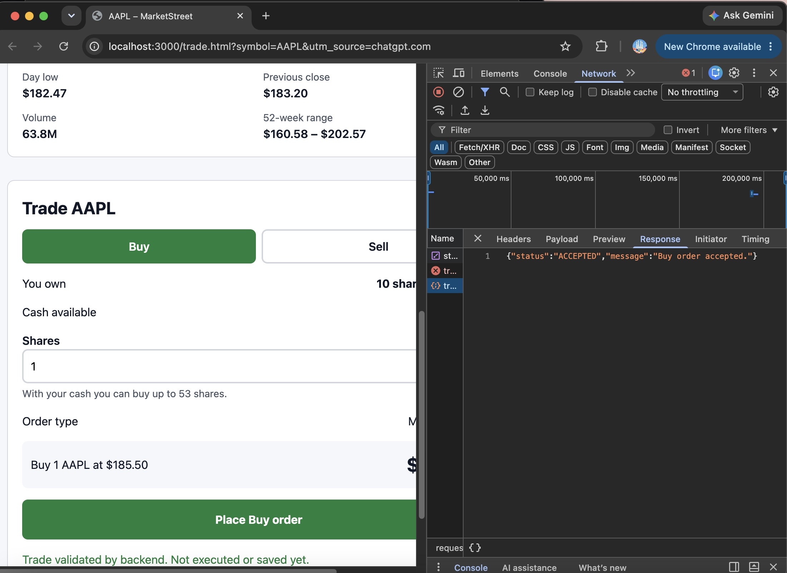
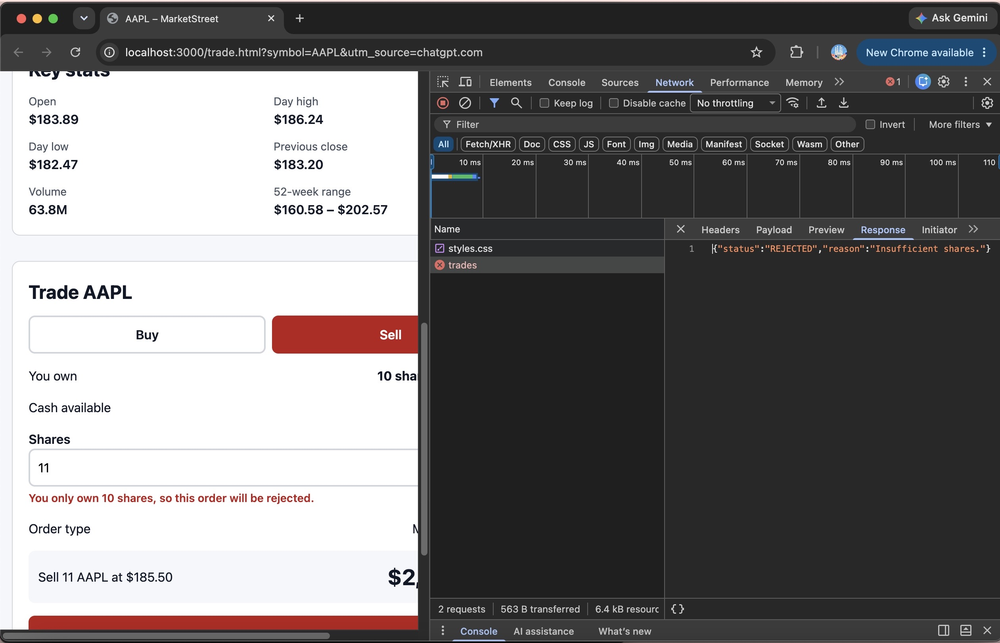
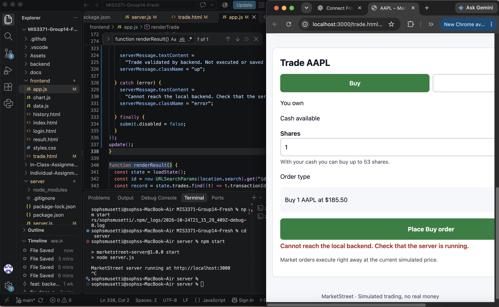

# Week 9 — Frontend and Backend Integration Tests

## Project
MarketStreet — Team 14

## Objective
Verify that the existing MarketStreet trading interface communicates with the local Express backend through HTTP POST requests and JSON responses.

## Testing Environment
- Local Express server: http://localhost:3000
- Endpoint: POST /api/trades
- Frontend: frontend/trade.html
- Backend logic: backend/backend.js
- Browser: Google Chrome

## Expected vs. Actual Results

| Test | Input | Expected Result | Actual Result | Outcome |
|---|---|---|---|---|
| 1 | Buy 1 AAPL share | HTTP 200, ACCEPTED | HTTP 200, ACCEPTED | Pass |
| 2 | Sell 11 shares, own 10 | HTTP 400, insufficient shares | HTTP 400, REJECTED, insufficient shares | Pass |
| 3 | Submit Buy with server stopped | Connection error | Connection error displayed | Pass |
| 4 | Sell 10 shares, own 10 | HTTP 200, ACCEPTED | HTTP 200, ACCEPTED | Pass |
| 5 | Buy 54 shares at $185.50 with $10,000 cash | HTTP 400, insufficient cash | HTTP 400, REJECTED, insufficient cash | Pass |
| 6 | Buy 53 shares at $185.50 with $10,000 cash | HTTP 200, ACCEPTED | HTTP 200, ACCEPTED | Pass |

## Network Verification
Chrome Developer Tools confirmed requests to POST /api/trades using fetch().

- Valid trades returned HTTP 200.
- Invalid trades returned HTTP 400.
- The backend returned structured JSON.
- When the server was unavailable, the frontend displayed a connection error.

## Screenshots — Network Evidence

### Accepted Trade

### Rejected Trade

### Connection Error

## Conclusion
All six integration tests passed. MarketStreet successfully sends trade requests from the browser to the local backend and displays validation results.

Week 9 validates trades locally. Transactions are not executed or persisted by this API.

## Contributor
Sophia Musetti — Frontend integration, browser testing, and documentation.
