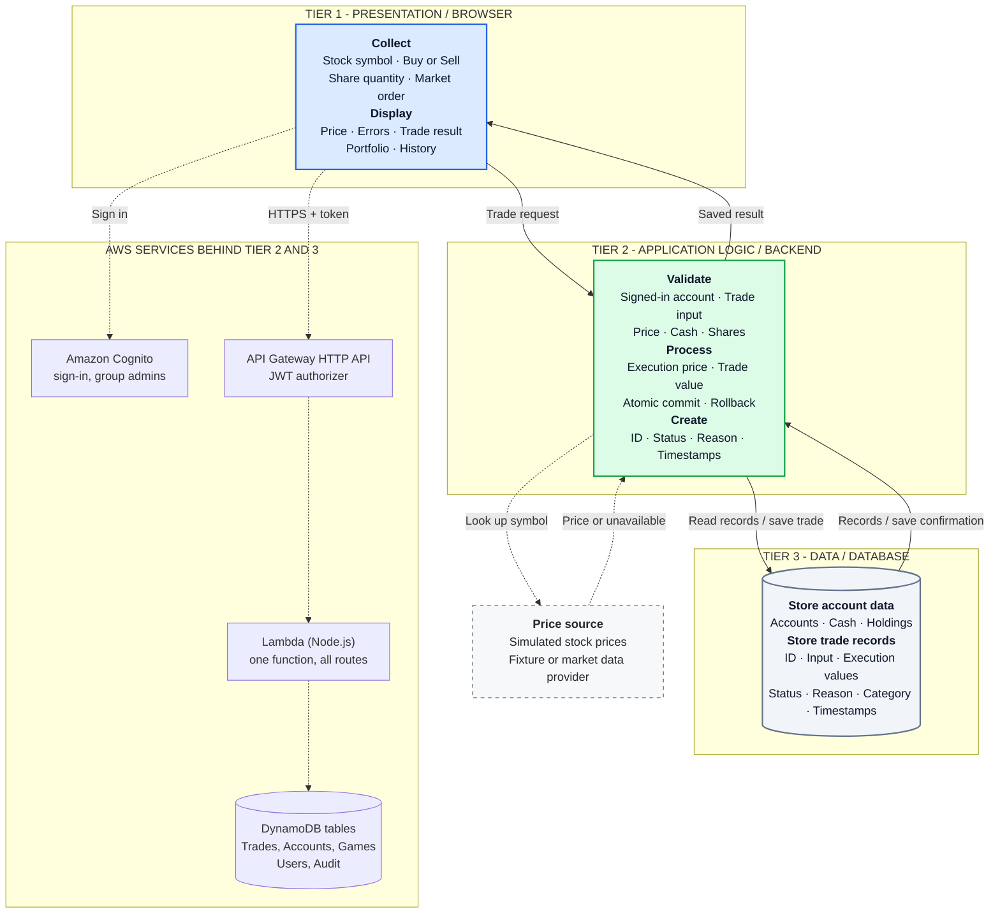

# MarketStreet — Three-Tier Architecture

**Presentation collects and displays. Application logic validates and decides. Data stores the official records.**

Only the application accesses the database. The price source supplies the application with prices; it is a dependency outside the three tier boxes. Prices from the price source are never taken from the browser, so the user cannot choose their own execution price (BR-9).

**Implementation status:** This is the built architecture. The [static frontend](../../frontend/index.html) is hosted on AWS Amplify. Users sign in with Amazon Cognito (group `admins` grants the admin role). The browser calls an API Gateway HTTP API whose JWT authorizer checks the token, and a single Node.js Lambda validates, executes and saves every trade. Data lives in five DynamoDB tables: `MarketStreetTrades` (transactionId), `MarketStreetAccounts` (userId), `MarketStreetGames` (gameId), `MarketStreetUsers` (userId: profile, role, disabled, tokensValidAfter) and `MarketStreetAudit` (auditId). Planned indexes: trades by `userId` + `submittedAt`, games by `ownerId` + `updatedAt`. Earlier browser-only interfaces that offer Limit orders are preserved as [archived coursework](../../archive/README.md).

## Why Lambda instead of EC2

Trade processing is short, request-driven work: a request arrives, the code runs for milliseconds, and it stops. Lambda has no operating system or server to patch, scales with the number of requests, and bills per request. EC2 suits long-running applications that need control of the operating system, which MarketStreet does not.

## Availability vs backup and recovery

These are different problems. **Availability** means the system keeps working: the managed multi-AZ services (Lambda, API Gateway, DynamoDB, Cognito) keep running if one data center fails. **Backup and recovery** means getting data back after a mistake: DynamoDB point-in-time recovery restores deleted or damaged records to an earlier moment. The application never deletes records (NFR-4), so recovery is only needed for operator error or damage outside the application.

Details: [Trade workflow](workflow.md) · [Data dictionary](data-dictionary.md) · [Trade states](state-diagram.md) · [Responsibility notes](short-responsibility-notes.md).
