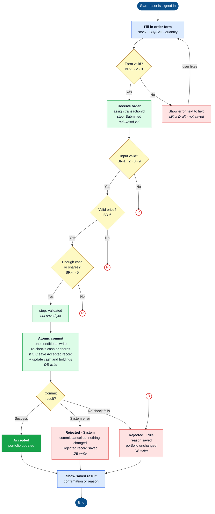

# MarketStreet — Stock Trade Order Workflow

**Main transaction:** User submits a simulated stock trade order (Market order).

## Legend

| Symbol | Meaning |
|---|---|
| Dark blue pill | Start / End |
| Blue box | **Presentation tier** (browser) step |
| Green box | **Application tier** step |
| Yellow diamond | Decision |
| Solid green box | Successful outcome |
| Red box | Error or rejection |
| Red circle **R** | Connector: continues at the **R** above "Rejected · Rule" |
| *DB write* | The step writes to the **data tier** (see table below) |

## Database Writes (Data Tier)

Only the application writes to the database. Each order is saved **once**, with its final status (D-19). Submitted and Validated are steps inside one Lambda call. They are never written to the database. Each *DB write* in the diagram is one of these writes.

| Outcome | What is saved | How | Notes |
|---|---|---|---|
| Accepted | The trade record with status `Accepted`, price fields and all timestamps, plus the new cash and holdings | One DynamoDB `TransactWriteItems` call (`commitTrade` in `backend/accounts.js`) | **One database transaction.** Either all of it is saved or none of it. Its condition re-checks cash (Buy) or shares (Sell). |
| Rejected · Rule | The trade record with status `Rejected`, `rejectionReason`, `rejectionCategory = Rule`, all timestamps; execution price, value and price timestamp if a valid price was obtained | One `PutCommand` (`saveRejected` in `index.js`) | Cash and holdings are never touched. |
| Rejected · System | The trade record with status `Rejected`, `rejectionReason`, `rejectionCategory = System`, all timestamps | The `TransactWriteItems` call failed, so nothing from it was saved. Then one `PutCommand` saves the Rejected record | The reply is HTTP 500. Cash and holdings keep their previous values. |

## Business Rules

| Rule | Meaning |
|---|---|
| BR-1 | Trade type is Buy or Sell. |
| BR-2 | Stock symbol is recognized. |
| BR-3 | Quantity is a positive whole number. |
| BR-4 | Buy orders have enough cash to cover the trade (re-checked inside the commit). |
| BR-5 | Sell orders have enough shares owned (re-checked inside the commit). |
| BR-6 | A valid stock price is available: greater than $0 and no more than 15 minutes old. |
| BR-7 | Accepted trades update cash, holdings, and the Accepted record in one atomic commit. |
| BR-8 | Rejected trades leave cash and holdings unchanged; a failed commit is rolled back. |
| BR-9 | Only Market orders are executed; Limit orders are rejected. |

## Save Rules

1. **One commit for an accepted trade.** Cash, holdings, and the Accepted record are written in one database transaction. Either all three are saved or none are. The diagram has no path where the portfolio changes but the record does not (or the reverse).
2. **Check again inside the commit.** DynamoDB does not lock the account. Instead, the commit is a conditional write: it only succeeds if the account still has enough cash (`cashCents >= cost`) or shares. If another order changed the account first, the condition fails and the order is saved as Rejected. Two orders submitted at the same time cannot both spend the same cash or sell the same shares.
3. **Save before showing.** The user sees a result only after it has been saved, for both Accepted and Rejected trades.
4. **Two kinds of rejection.** `Rule` means the order broke a business rule (BR-1 to BR-6 or BR-9) or the request was malformed. `System` means the order was valid but the commit failed, so nothing changed. Both end in the Rejected status, and the category keeps them apart in history and audits.
5. **If a save itself fails.** If the database cannot save a record at all, the user is told the order was not saved and to try again. The reply never says `persisted: true`, and the user's cash and holdings are not touched.

Details: [Business rules](../02-requirements/business-rules.md) · [Trade states and exception paths](state-diagram.md) · [Three-tier architecture](architecture.md) · [Data dictionary](data-dictionary.md).
